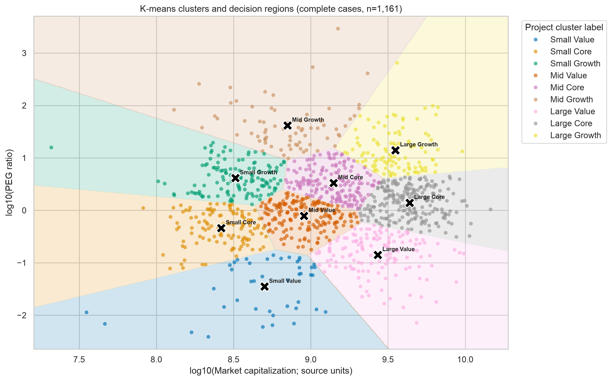
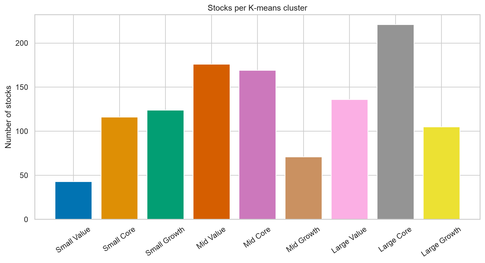
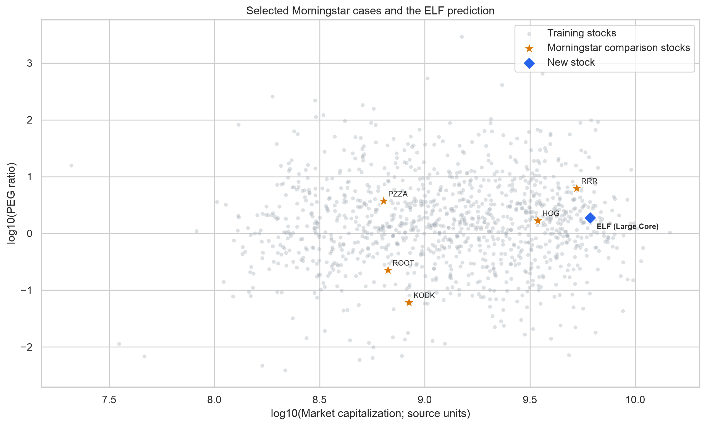
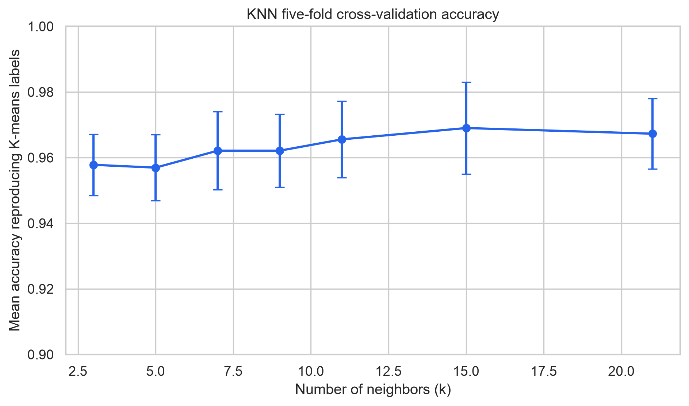

# Stock Classification with K-means and KNN

**Course:** FIM 590-003 Machine Learning in Finance  
**Project:** Project 02  
**Group:** Joy Wu, Luolin Zhang, Jialin Zhang  
**Due:** November 23, 2026, 11:59 p.m.

## Executive summary

This project groups the course-provided Russell 2000 sample into nine Size × Style categories using market capitalization and the price/earnings-to-growth (PEG) ratio. The source file contains 1,958 rows. PEG is missing for 797 rows, so the model uses 1,161 observations with complete, positive values. Both features are transformed with `log10` and standardized. K-means is then fitted with nine clusters (`n_init=50`, `random_state=42`). The silhouette score is 0.3423, which shows moderate separation and overlap between nearby clusters.

The centroids are first ranked by market capitalization and divided into Small, Mid, and Large groups. Within each group, PEG centroids are ranked from low to high and named Value, Core, and Growth. These labels are defined for this project and do not use Morningstar cutoffs. Of the five documented stocks, two match Morningstar on size. None match on style or the full Style Box. A separate nine-stock check covers one representative from every cluster. Its team-provided source summary reports one exact match, but it does not include the underlying Morningstar links or access dates, so Appendix B presents it as supplementary evidence.

A distance-weighted KNN classifier is trained to match the K-means labels. Stratified five-fold cross-validation selects `k=15`. Mean label agreement is 96.90%, with a fold standard deviation of 1.40 percentage points. Bloomberg reports ELF market capitalization at USD 6.120 billion and Estimated PEG at 1.87. Both KNN and a direct K-means check classify ELF as **Large Core**.

## 1. Objective

The assignment asks for nine K-means clusters based on market capitalization and PEG. It also asks for economic labels for each cluster, a Morningstar comparison for selected companies, a discussion of the cluster boundaries, and a KNN classification for one new stock. Ticker identifies each company but is not used as a model feature.

## 2. Data and audit

The supplied `data/equity_data.csv` has 1,958 unique tickers. Market capitalization has no missing values. PEG is missing for 797 rows (40.70%), so the analysis uses 1,161 rows (59.30%). All retained feature values are positive.

| Audit item | Result |
| --- | ---: |
| Source rows / unique tickers | 1,958 / 1,958 |
| Missing market capitalization | 0 |
| Missing PEG | 797 (40.70%) |
| Rows used | 1,161 (59.30%) |
| Rows excluded | 797 |

The file does not report the Russell 2000 constituent date, feature observation date, data provider, market-capitalization currency or unit, or PEG definition. We describe it only as the course-provided Russell 2000 sample. We do not infer the missing source details.

## 3. Preprocessing and model design

The two raw features are right-skewed, and their scales differ. Rows with a missing or nonpositive value are removed. The remaining values are transformed with `log10` and standardized. K-means and the direct K-means check use a scaler fitted to the training sample. During KNN cross-validation, the scaler is fitted again within each training fold. This keeps information from the held-out fold out of preprocessing.

The assignment requires nine clusters to represent the nine Size × Style combinations. The number of clusters is fixed rather than selected from the silhouette score. The labeling rule is:

1. Order the nine centroids by back-transformed market capitalization.
2. Split the ordered centroids into three groups of three and call them Small, Mid, and Large.
3. Within each group, order the PEG centroids from low to high and call them Value, Core, and Growth.

Because the model is fitted on logged features, the back-transformed centroids act like geometric centers. They are not arithmetic means or fixed financial cutoffs.

## 4. K-means results

| Project label | Raw cluster | Market-cap center (source scale ÷ 1B) | PEG center | Stocks | Share |
| --- | ---: | ---: | ---: | ---: | ---: |
| Small Value | 3 | 0.502 | 0.035 | 43 | 3.7% |
| Small Core | 6 | 0.263 | 0.459 | 116 | 10.0% |
| Small Growth | 5 | 0.325 | 4.123 | 124 | 10.7% |
| Mid Value | 2 | 0.903 | 0.787 | 176 | 15.2% |
| Mid Core | 8 | 1.402 | 3.323 | 169 | 14.6% |
| Mid Growth | 0 | 0.706 | 41.530 | 71 | 6.1% |
| Large Value | 1 | 2.716 | 0.141 | 136 | 11.7% |
| Large Core | 7 | 4.361 | 1.399 | 221 | 19.0% |
| Large Growth | 4 | 3.534 | 14.052 | 105 | 9.0% |



K-means assigns each stock to its nearest centroid. The boundaries are straight lines in standardized log-feature space and appear as sloped regions on the log-scale plot. Morningstar uses a rectangular Style Box and more than two factors, so the plotted regions should not be read as Morningstar cutoffs. The silhouette score of 0.3423 shows moderate separation and overlap between nearby clusters.



Large Core contains the most stocks, with 221 observations or 19.0% of the sample. Small Value contains the fewest, with 43 observations or 3.7%. K-means minimizes within-cluster squared distance and does not require clusters to have equal sizes.

## 5. Morningstar comparison

The Morningstar pages were accessed on November 22, 2026. None of the reviewed pages displayed a separate effective date for the Stock Style Box, so the date field is recorded as `Not shown`.

| Ticker | Model label | Morningstar label | Size match | Style match |
| --- | --- | --- | --- | --- |
| KODK | Small Value | Small Core | Yes | No |
| PZZA | Small Growth | Small Value | Yes | No |
| ROOT | Mid Value | Small Growth | No | No |
| HOG | Large Core | Small Value | No | No |
| RRR | Large Growth | Small Core | No | No |

KODK and PZZA match Morningstar on size but not on style. ROOT, HOG, and RRR match on neither dimension. None of the five stocks matches the full Morningstar Style Box. The project model uses only market capitalization and PEG, while Morningstar uses additional factors. The five stocks were chosen for discussion rather than as a random validation sample. The 0/5 result does not estimate performance for all stocks.



Appendix B adds a separate check using the stock closest to each of the nine fitted centroids. It is not combined with the five documented cases because the uploaded summary does not include the original Morningstar links or access dates.

## 6. KNN model selection

KNN uses the same two log-transformed features. Its target is the set of nine labels produced by K-means. Several values of `k` are tested with shuffled, stratified five-fold cross-validation and distance weighting.

| k | Mean agreement | Fold SD |
| ---: | ---: | ---: |
| 3 | 95.78% | 0.93 pp |
| 5 | 95.69% | 1.01 pp |
| 7 | 96.21% | 1.19 pp |
| 9 | 96.21% | 1.11 pp |
| 11 | 96.56% | 1.17 pp |
| 15 | **96.90%** | 1.40 pp |
| 21 | 96.73% | 1.07 pp |



The candidate scores are close, and their fold variation overlaps. `k=15` has the highest mean score, but it is only about 0.17 percentage point above `k=21`. The reported 96.90% is agreement with K-means labels created from the same two features. It does not measure agreement with Morningstar, future investment returns, or an independent classification standard.

## 7. ELF classification

ELF (`e.l.f. Beauty, Inc.`) does not appear in the training file. Bloomberg Terminal (`ELF US Equity > DES > Profile`) displayed `Mkt Cap (USD) 6,120.0M` and `Est PEG 1.87` when accessed on November 22, 2026. The model inputs are 6,120,000,000 and 1.87. The separate `BEST_PEG_RATIO` field returned `N.A.` and is not used.

| Item | Result |
| --- | --- |
| Market capitalization | USD 6.120 billion |
| PEG | 1.87, Bloomberg Estimated PEG |
| Market-cap percentile in training sample | 95.0th |
| PEG percentile in training sample | 56.4th |
| KNN prediction | **Large Core** |
| Direct K-means check | **Large Core** |
| Model agreement | Yes |

Each ELF input falls within the observed range for that feature in the training sample. ELF is not outside the training range on either feature. KNN and K-means return the same label, but this is only an internal consistency check. The training file does not state its market-capitalization currency or unit, or its PEG definition. The ELF classification assumes that the training market-cap values use a scale comparable to the Bloomberg USD value. It also uses Estimated PEG even though the training PEG convention is unknown.

## 8. Discussion and limitations

- **Data coverage and source details:** PEG is missing for 40.70% of the source rows. The complete-case sample may differ from the excluded stocks. The training file also omits the constituent date, observation date, provider, and feature definitions. Index membership and company values can change over time.
- **Feature comparability:** Bloomberg reports ELF's value as Estimated PEG, while the training PEG definition is unknown. The training market-capitalization currency and unit are also undocumented.
- **Model scope:** The model uses only market capitalization and PEG, so it cannot reproduce Morningstar's multi-factor method. The Size × Style names are based on the order of the fitted centroids, not external cutoff points. The silhouette score of 0.3423 also shows that nearby clusters overlap.
- **Validation scope:** KNN cross-validation measures agreement with K-means labels, not with an independent target. The five documented Morningstar stocks are selected examples and cannot support an accuracy claim for the full stock sample. The separate nine-stock summary lacks the original Morningstar links and access dates, so it is reported only as supplementary evidence.

## 9. Conclusion

After log transformation and standardization, K-means divides the 1,161 complete observations into the nine required Size × Style categories. These labels are relative to this sample and are not Morningstar definitions. The five selected stocks show that the model can agree with Morningstar on size while disagreeing on style. With `k=15`, KNN matches the K-means labels in 96.90% of cross-validation predictions and classifies ELF as Large Core. K-means gives the same ELF label. This result shows consistency between the two project models. It does not measure Morningstar accuracy or investment performance.

## Appendix A. Key Python code

```python
# Clean, transform, and standardize the two model features
valid = df[["Market_capital", "PEG ratio"]].notna().all(axis=1)
valid &= (df[["Market_capital", "PEG ratio"]] > 0).all(axis=1)
modeled = df.loc[valid].copy()
modeled["Log10_Market_capital"] = np.log10(modeled["Market_capital"])
modeled["Log10_PEG_ratio"] = np.log10(modeled["PEG ratio"])
scaled = StandardScaler().fit_transform(
    modeled[["Log10_Market_capital", "Log10_PEG_ratio"]]
)
```

```python
# Nine-cluster K-means required by the assignment
kmeans = KMeans(n_clusters=9, n_init=50, random_state=42)
raw_labels = kmeans.fit_predict(scaled)

# Project labeling rule: centroid market cap, then within-group PEG
market_order = centers.sort_values("Center_Market_capital").index.to_list()
for size_index, size_name in enumerate(["Small", "Mid", "Large"]):
    group = market_order[size_index * 3:(size_index + 1) * 3]
    peg_order = centers.loc[group].sort_values("Center_PEG_ratio").index
```

```python
# Distance-weighted KNN; scaling is fitted inside each CV fold
pipeline = Pipeline([
    ("scaler", StandardScaler()),
    ("knn", KNeighborsClassifier(n_neighbors=k, weights="distance")),
])
scores = cross_val_score(
    pipeline, X_log, kmeans_style_labels,
    cv=StratifiedKFold(5, shuffle=True, random_state=42),
    scoring="accuracy",
)

# Final ELF classification
knn.fit(X_log, kmeans_style_labels)
elf_label = knn.predict([[np.log10(6_120_000_000), np.log10(1.87)]])
```

The full code is in `src/stock_clustering.py`. The executed results are in `model/model.ipynb`.

## Appendix B. Supplementary cluster representatives

For each cluster, the representative stock is the observation closest to the fitted centroid in standardized log-feature space. The model reproduces the nine representatives shown in the team comparison. The summary reports three size matches, three style matches, and one exact match. Because it does not include the original Morningstar links, access dates, or individual source screenshots, these results are not combined with the five documented cases.

| Ticker | Model label | Team summary | Difference |
| --- | --- | --- | --- |
| JAKK | Small Value | Small Value | None |
| ASLE | Small Core | Small Value | Style |
| ARL | Small Growth | Small Value | Style |
| WGO | Mid Value | Small Value | Size |
| IBTA | Mid Core | Small Value | Both |
| BFS | Mid Growth | Small Value | Both |
| ARDT | Large Value | Small Value | Size |
| HCC | Large Core | Small Value | Both |
| REZI | Large Growth | Small Value | Both |

Evidence record: `K-Means Comparison.png`, GitHub commit `4fd2bfc77d111f510a3db60e104698e75a8f2e61`. The commit date is not treated as the Morningstar access date.

## References and data sources

1. FIM 590-003, Project 02 assignment (`Project_Overview.pdf`).
2. Course-provided stock file (`data/equity_data.csv`); source metadata not supplied.
3. Morningstar stock pages for KODK, PZZA, ROOT, HOG, and RRR, accessed November 22, 2026; direct URLs are stored in `data/input/favorite_stocks.csv`.
4. Bloomberg Terminal, `ELF US Equity > DES > Profile`, accessed November 22, 2026.
5. Team-provided `K-Means Comparison.png`, GitHub commit `4fd2bfc77d111f510a3db60e104698e75a8f2e61`, November 22, 2026; original Morningstar access dates were not supplied.
